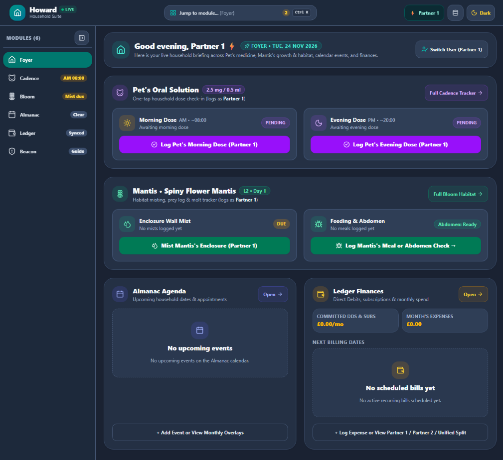

<div align="center">

# Howard

**Self-hosted household hub for daily routines, pet and mantis care, shared calendars, household bills, and clinical symptom logs.**

[](https://react.dev/)
[](https://vite.dev/)
[](https://tailwindcss.com/)
[](https://nodejs.org/api/sqlite.html)
[](https://www.docker.com/)

<br />



</div>

---

## Overview

Howard brings eight household tools together in one lightweight Docker container on port `5170`, backed by Node.js 22 built-in SQLite (`node:sqlite`, unflagged). Connected devices stay in sync across phones, tablets, and desktops via Server-Sent Events (SSE) push with a 3-second polling fallback (30-second keepalive when SSE is active), alongside in-memory gzip compression and ETag caching for static assets.

The interface adapts across screen sizes with a collapsible sidebar rail on desktop, a `Ctrl+K` / `Cmd+K` quick module switcher, and a floating navigation pill on mobile. Both **Warm Beige** and **Softened Dark** themes are supported across every view, alongside dedicated print styling for clinical reports.

## Modules

| Module | Description |
| :--- | :--- |
| **Foyer** | Daily household briefing surfacing AM and PM pet dose status, mantis misting and feeding safety alerts, upcoming calendar dates, monthly bill totals, and one-tap care check-ins. |
| **Cadence** | Twice-daily pet medication tracker with morning and evening dose logging, double-dose prevention, adherence tracking, opened bottle expiry monitoring, and weekly history. |
| **Bloom** | Spiny flower mantis care tracker covering daily misting intervals, prey feeding and abdomen condition, premolt and post-molt hardening lockouts, instar growth milestones, feeder culture alerts, and enclosure clearance checks. |
| **Almanac** | Shared household calendar supporting recurring events and toggleable overlays for pet medication logs, bottle expiry dates, mantis molts and care, upcoming bills and paydays, and Partner 2's private cycle logs. |
| **Floodgate** | Private cycle and clinical symptom log recording flow severity, clot counts and sizes, 0 to 10 pain scores, GI flare-ups, medication relief, cycle patterns, and printable GP consultation reports. |
| **Ledger** | Household bookkeeping manager tracking day-to-day expenses, Direct Debits, subscriptions, and income across Partner 1, Partner 2, Joint, and Unified views with 50/50 or income-proportional settlements and CSV export. |
| **Quill** | Keep-style tileable notes & shared household board with drag-and-drop ordering, checklists, Markdown-lite formatting, labels, 12 note colours, private per-partner boards, and optional Caregiver House Notes. |
| **Beacon** | Caregiver and household reference card covering pet routines, supply locations, daytime and 24-hour emergency vet contacts, household contacts, Wi-Fi sharing, bin collection days, and utilities. |

---

## Profiles & Privacy

Access adapts to the active household profile. **Partner 1** and **Partner 2** display names can be renamed in-app, while **Caregiver** stays fixed for sitter access:

* **Partner 1**: Full access to Foyer, Cadence, Bloom, Almanac, Ledger, Quill, and Beacon, plus full database export and JSON restore/merge permissions.
* **Partner 2**: Full access to Foyer, Cadence, Bloom, Almanac, Floodgate, Ledger, Quill, and Beacon, plus full database export.
* **Caregiver**: Always unlocked for guests and pet sitters; scopes navigation to Caregiver Foyer, Cadence, Bloom, read-only Quill House Notes, and read-only Beacon.

### Security Model

Howard is designed for trusted home LANs and private VPNs (such as Tailscale) rather than public internet multi-tenancy:

* **Optional PIN Lock**: Partner 1 and Partner 2 can each set a 4 to 8 digit numeric PIN to prevent casual profile switching on shared tablets. These are lightweight local locks rather than internet-facing authentication.
* **Private Data Filtering**: Floodgate is strictly scoped to Partner 2 in both the UI and API sync payloads. Partner 2 private events and GP-report-linked entries in Almanac are filtered out of Partner 1 and Caregiver views.

---

## Database & Backups

All modules persist atomically in `./data/howard.db` (`/app/data/howard.db` in Docker) using SQLite schema `user_version = 6` and `WAL` journal mode by default. Legacy multi-database setups (`cadence.db`, `bloom.db`, `floodgate.db`) archive automatically into `./data/backups/legacy-4db-*/` and consolidate on first boot.

* **Daily Snapshots**: Compacted daily snapshots are written via `VACUUM INTO` to `./data/backups/YYYY-MM-DD/howard.db` and pruned after 7 days. Dated snapshot files can be copied safely without stopping Docker.
* **JSON Export & Restore**: Partner 1 and Partner 2 can download a full household JSON backup (including Floodgate) from the Database Backstage menu. Only Partner 1 can upload restores, supporting full Howard replacement (`mode: "replace"`) and merging standalone Cadence, Bloom, or Floodgate JSON backups (`mode: "merge"`). Every restore saves a pre-restore `VACUUM INTO` snapshot to `./data/backups/pre-restore-*/` first.
* **Cold File Copy**: If backing up `./data/howard.db` directly instead of copying a daily snapshot, stop the container briefly so active `-wal`/`-shm` journals flush cleanly:

```bash
docker compose stop
# Copy ./data to your backup destination
docker compose start
```

## Project Structure

```text
.
├── server.js                  # CLI entrypoint booting createHowardApp()
├── server/                    # Modular backend (SQLite db, migrations, cache, backup, HTTP/SSE, domain routes)
├── shared/                    # Isomorphic date, profile/RBAC, and default settings helpers shared by client & server
├── docs/                      # Documentation media
├── src/
│   ├── App.jsx                # Root app shell, theme state, and lazy-loaded module routing
│   ├── index.css              # Tailwind v4 @theme semantic tokens, Warm Beige & Softened Dark palettes, print styles
│   ├── components/HowardUI.jsx
│   ├── components/shell/      # Header, desktop rail, mobile floating pill, Bento switcher, Profile & Backstage modals
│   ├── hooks/                 # Live SSE sync (useHouseholdSync), action locks, week navigation
│   ├── utils/                 # Shared helpers and apiClient
│   └── apps/                  # 8 module workspaces and their decomposed tabs/modals
└── tests/                     # Built-in node:test unit and SQLite server integration suites
```

---

## Getting Started (Docker)

### Docker Compose (Recommended)

`docker-compose.yml` configures `TZ=Europe/London` by default so daily medication windows, calendar boundaries, and recurring bills align with your household timezone. Adjust `TZ` before starting if needed.

```bash
docker compose up -d --build
```

Howard will be available at `http://localhost:5170` (or `http://<SERVER-LAN-IP>:5170` across your home network).

### Upgrading

Pull new changes and rebuild without modifying `./data`:

```bash
git pull
docker compose up -d --build
```

### Storage & NAS Notes (`docker-compose.yml`)

* **Docker Named Volume**: Uncomment `howard_data:/app/data` and the top-level `volumes:` block to keep SQLite on native Linux `ext4` under Docker Desktop.
* **SMB / NFS Network Shares**: Uncomment `SQLITE_JOURNAL_MODE=TRUNCATE` if `./data` sits on a network share where SQLite `WAL` shared-memory locking is unsupported.

### Standalone `docker run`

```powershell
docker build -t howard .
docker run -d --name howard -p 5170:80 -e TZ=Europe/London -v "${PWD}/data:/app/data" --restart unless-stopped howard
```

### Windows Firewall (Optional LAN Access)

```cmd
netsh advfirewall firewall add rule name="Allow Howard 5170" dir=in action=allow protocol=TCP localport=5170 profile=any
```

## Local Development

Requires **Node.js 22.13+** for unflagged `node:sqlite`.

```bash
npm ci
```

Run the API server and Vite dev server in separate terminals:

```powershell
# Terminal 1 (Windows PowerShell): unified API & SQLite server on port 3001
$env:PORT=3001; npm start
```

```bash
# Terminal 1 (macOS / Linux / Git Bash)
PORT=3001 npm start

# Terminal 2: Vite dev server on port 5170 (proxies /api to 3001)
npm run dev
```

Run tests, linter, and production builds:

```bash
npm test       # Unit & SQLite server integration tests (node --test)
npm run lint   # Static linting (oxlint)
npm run build  # Production bundle -> ./dist
```
